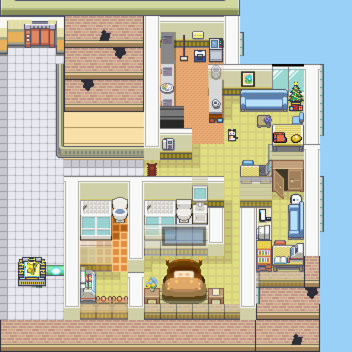
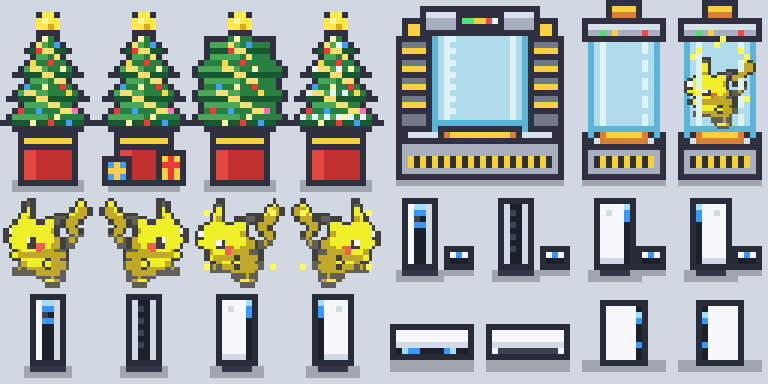

# Pokémon FireRed / LeafGreen Style Home Assistant Floorplan

An interactive **Pokémon Generation III (FireRed / LeafGreen / Pokémon Essentials)** pixel-art floorplan dashboard for **Home Assistant**, built with `picture-elements`, **Tiled Map Editor**, custom 2× GBA-scale pixel art, and AI-assisted sensor discovery via **MCP (Model Context Protocol)** and the Home Assistant API.



---

## ✨ Features

- **Automatic Day / Night Cycle (`sun.sun`):** Dynamically transitions between a bright daytime base map (`floorplan_day.png`) with a sky-blue exterior and a nighttime base map (`floorplan_night.png`) when the sun goes below the horizon.
- **Per-Room Clipped Lighting Overlays:** Individual soft-feathered warm light overlays (`light_kitchen_1.png`, `light_kitchen_2.png`, `light_living_1.png`, `light_living_2.png`, `light_study.png`, `light_bedroom.png`, `light_wardrobe.png`, `light_bathroom_guest.png`, `light_bathroom_master.png`) with hard wall-boundary clipping so light never bleeds across walls or into adjacent rooms.
- **Smart Character Presence & Room Tracking (Ash/Red & Misty):**
  - Displays **Ash / Red** when `person.luis` is `home` and **Misty** when `person.mafecita` is `home`.
  - Rather than relying solely on mmWave occupancy sensors (which can be triggered by moving window blinds or an oscillating fan), characters move dynamically between **Workstations**, the **Master Bedroom**, and the **Living Room / Kitchen** using **Home Assistant Threshold Binary Sensor Helpers** driven by real-time smart plug wattage (`stu5` Study PC desk `> 5W`, `liv4` Living Room PC desk `> 5W`, and Bedroom TV `> 15W`).
- **Viridian Pokémon Center Pikachu Power Generator (Anime Episode 2):**
  - Inspired by the classic Pokémon anime episode *"Pokémon Emergency!"*, an external hallway **Crystal Containment Cage** houses an animated **`pikachu_thunder.gif`** sprite that bounces and discharges yellow/white Thunderbolt lightning arcs to side Tesla coils, paired with a live label showing total apartment power consumption (`sensor.total_apartment_power`).
- **PlayStation 5 & Retro CRT TV "Now Playing" Game Cover:**
  - Custom `1×1` PlayStation 5 + DualSense controller tile placed above a retro CRT TV in the Study.
  - When a PS5 game is actively running (`sensor.lordvault_now_playing` is not `unknown`/`unavailable`), a miniature cover art preview (`image.lordvault_now_playing`) glows directly on the CRT TV screen.
- **Dynamic `4×3` Pixel-Art Outdoor Weather (`weather.home`):**
  - Top-right sky corner displays a `128×96` px (`4×3` tiles) pixel-art weather scene (`sunny`, `clear-night`, `partlycloudy`, `cloudy`, `rainy`, `pouring`/`lightning`, `fog`, `windy`) alongside the live outdoor temperature.
- **Seasonal Tiled Layers (`Plants` vs. `Christmas`):**
  - Dedicated toggleable layers in `mapita_pokemon.tmx` to switch between regular indoor houseplants and decorated Christmas trees with holiday gifts.

---

## 🎨 Credits, Inspiration & Base Tilesets

1. **Community Inspiration & Tilesets:**
   - Inspired by [u/katschung's Pokémon Style Floorplan post on r/homeassistant](https://www.reddit.com/r/homeassistant/comments/1hrkku1/pokemon_style_floorplan/).
   - Community interior tilesets shared in the thread:
     - [`tilesets/imgur_kIBvowP.png`](https://imgur.com/kIBvowP)
     - [`tilesets/imgur_RriSFxo.png`](https://imgur.com/RriSFxo)
2. **Official Pokémon Essentials (FireRed / LeafGreen RMXP) Tilesets:**
   - [`tilesets/Interior_general.png`](tilesets/Interior_general.png) — Base floors, walls, kitchen counters, sinks, beds, tables, and plants (`32×32` px tiles at 2× GBA pixel scale).
   - [`tilesets/Department_store_interior.png`](tilesets/Department_store_interior.png) — Display counters, vending machines, and elevator doors.
   - [`tilesets/Mansion_interior.png`](tilesets/Mansion_interior.png) — Decorative interior accents.
   - Overworld trainer sprites (`trchar000.png` for Red/Ash, `trchar060.png` for Misty) and Pikachu (`icon025.png`) from Pokémon Essentials v17.2.

---

## 🛠️ Custom Tileset (`tilesets/custom_home_items.png`)

To represent specific real-world appliances, pets, and Pokémon easter eggs in our apartment, we generated [`tilesets/custom_home_items.png`](tilesets/custom_home_items.png) (`256×960` px, 8 columns × 30 rows of `32×32` px tiles) using Python (`Pillow`) at authentic 2× GBA pixel scale:

| Rows | Columns | Dimensions | Description |
| :--- | :--- | :--- | :--- |
| **0–1** | `0–3` / `4–7` | `1×2` (`32×64`) | Silver & White Top-Load Washing Machines (4 directions: `S, N, E, W`) |
| **2** | `0–3` / `4–7` | `1×1` (`32×32`) | Covered Hooded Cat Litter Box & Cat Food/Water Bowls (`S, N, E, W`) |
| **3** | `0–3` | `1×1` (`32×32`) | Open Sandy Cat Litter Tray (`S, N, E, W`) |
| **4–5** | `0–3` / `4–7` | `1×2` (`32×64`) | Red Mop Bucket with Mop & Standalone Mop (`S, N, E, W`) |
| **6** | `0–3` | `1×1` (`32×32`) | Compact Red Mop Bucket (`S, N, E, W`) |
| **7–8** | `0–7` | `1×1` (`32×32`) | Calico Cat Sprites — Sitting, Eating, and Sleeping (`S, N, E, W`) |
| **9–10** | `0–7` | `1×1` (`32×32`) | Xiaomi Mijia 1C Robot Vacuum ("Robotina") + Charging Dock (`S, N, E, W`) |
| **11–13** | `0–3` / `4–7` | `1×2` & `1×1` | Ash / Red (`person.luis`) & Misty (`person.mafecita`) Overworld Sprites (`S, N, E, W`) |
| **14–15** | `0–3` | `1×2` (`32×64`) | 4 Decorated Christmas Tree Variants (Classic, With Gifts, Full-Mask, Snowy) |
| **14–15** | `4–5` / `6–7` | `2×2` & `1×2` | Viridian Pokémon Center Crystal Power Generator Cage (`64×64` & `32×64`) |
| **16** | `0–3` | `1×1` (`32×32`) | Pikachu Overworld Sprites (Idle & Sparking) |
| **16–17** | `4–7` / `0–7` | `1×1` (`32×32`) | PlayStation 5 Consoles (Vertical + DualSense, Vertical Only, Horizontal in `S, N, E, W`) |
| **18–29** | `0–3` / `4–7` | `4×3` (`128×96`) | 8 Outdoor Weather Banners (`sunny`, `clear-night`, `partlycloudy`, `cloudy`, `rainy`, `lightning`, `fog`, `windy`) |




---

## 🗺️ Designing the Map Manually in Tiled

The apartment layout was designed manually using **[Tiled Map Editor](https://www.mapeditor.org/)** (installed via Flatpak as `org.mapeditor.Tiled`):

```bash
flatpak install flathub org.mapeditor.Tiled
flatpak run org.mapeditor.Tiled mapita_pokemon.tmx
```

### Layer Architecture in `mapita_pokemon.tmx` (`22×22` tiles = `704×704` px)
1. **`1_Floors`**: Room floor tiles (wood planks, kitchen tiles, bathroom tiles, exterior hallway, and sky-blue background `#98D0F8`).
2. **`2_1_Walls_trans`** (`opacity="0.5"–"0.6"`): Translucent cutaway south/interior walls (such as the translucent wall between the Living Room desk and the Study, and the north wall of the Master Bedroom) so furniture and characters behind them remain visible.
3. **`2_Walls`**: Solid interior/exterior walls, windows, and cutaway wall tops.
4. **`3_Furniture_Base`**: Base furniture layer (beds, sofas, tables, kitchen counters, bathroom fixtures).
5. **`4_Furniture_Overlay`** & **`4_Furniture_Trans`**: Upper furniture details (TVs, computers, PS5, washing machine, Robotina vacuum, Pikachu crystal generator cage).
6. **`Plants`** (`visible="0"` during holidays) & **`Christmas`** (`visible="1"` during holidays): Seasonal decoration layers.

---

## 🤖 Role of AI & Home Assistant MCP Integration

This project was built by pair-programming with an AI coding agent (**Antigravity**) connected directly to our **Home Assistant** instance via **MCP (Model Context Protocol)** and the Home Assistant REST API:

1. **Automated Entity & History Discovery:**
   - Before writing any Lovelace YAML, the agent queried Home Assistant's live state registry and historical state transitions (`/api/states` and `/api/history/period`) to inspect exact entity IDs, attributes, and state behaviors.
   - For example, inspecting `image.lordvault_now_playing` vs. `sensor.lordvault_now_playing` revealed that `image.lordvault_now_playing` retains its last timestamp when idle, whereas `sensor.lordvault_now_playing` cleanly transitions to `"unknown"`—allowing the CRT TV game cover miniature to hide automatically when no game is being played.
   - Similarly, inspecting `weather.home` (Met.no) history identified all active weather states to design matching `4×3` pixel-art banners.
2. **Solving Presence False-Positives with Smart Plug Telemetry:**
   - Because open windows moving the blinds and an oscillating bedroom fan triggered the apartment's mmWave presence sensors (`binary_sensor.sonoff_snzb_06p_*`), the agent analyzed power consumption sensors across the apartment (`sensor.stu5_current_consumption`, `sensor.liv4_current_consumption`, and `sensor.sonoff_10015da5c1_power`).
   - Since Home Assistant's `picture-elements` `type: conditional` element only validates `state` / `state_not` (and throws a `Configuration error` on raw `above:` / `below:` keys), the agent programmatically created three native **Threshold Binary Sensor Helpers** via Home Assistant's config flow API (`/api/config/config_entries/flow`) with built-in hysteresis (`> 5W` for desks, `> 15W` for the Bedroom TV).
3. **Programmatic Pixel-Art & Lighting Pipeline:**
   - The agent authored Python scripts (`scripts/generate_custom_tileset.py`, `scripts/render_tmx.py`, and `scripts/generate_ha_floorplan.py`) to render the `.tmx` map, synthesize custom 2× GBA tiles and animated GIFs (`pikachu_thunder.gif`), and compute Gaussian-feathered room light masks with `exclude_rects` clipping so lighting stays strictly within each room's walls.

---

## 📁 Repository Structure

```text
ha_floorplan/
├── README.md                          # Project documentation & setup guide
├── lovelace_pokemon_floorplan.yaml    # Home Assistant picture-elements dashboard configuration
├── mapita_pokemon.tmx                 # Tiled Map Editor project file (22x22 tiles @ 32x32px)
├── tilesets/                          # Base Pokémon Essentials + Imgur + Custom tilesets (.png & .tsx)
│   ├── Interior_general.png / .tsx
│   ├── Department_store_interior.png / .tsx
│   ├── Mansion_interior.png / .tsx
│   ├── imgur_kIBvowP.png / .tsx
│   ├── imgur_RriSFxo.png / .tsx
│   └── custom_home_items.png / .tsx
├── www/                               # Assets to copy to Home Assistant's /config/www/pokemon_floorplan/
│   ├── floorplan_day.png              # Daytime base map
│   ├── floorplan_night.png            # Nighttime base map
│   ├── transparent.png                # 1x1 transparent placeholder
│   ├── light_*.png                    # Per-room clipped lighting overlays
│   ├── red_n/s/e/w.png                # Ash/Red directional sprites
│   ├── misty_n/s/e/w.png              # Misty directional sprites
│   ├── pikachu_thunder.gif            # Animated Pikachu Thunderbolt generator GIF
│   ├── pikachu_idle.gif               # Animated Pikachu idle generator GIF
│   ├── christmas_tree.png             # Standalone Christmas tree sprite
│   └── weather_*.png                  # 8 dynamic 4x3 outdoor weather banners
├── scripts/                           # Python build scripts (requires Pillow)
│   ├── render_tmx.py                  # Renders mapita_pokemon.tmx -> mapita_rendered.png
│   ├── generate_ha_floorplan.py       # Generates day/night maps & room lighting overlays in www/
│   └── generate_custom_tileset.py     # Generates custom_home_items.png & animated Pikachu GIFs
└── references/                        # Reference screenshots, tile previews, and early drafts
```

---

## 🚀 How to Build & Deploy to Home Assistant

1. **Edit the Map in Tiled (Optional):**
   Open `mapita_pokemon.tmx` in Tiled Map Editor, modify any layer, and save.
2. **Re-render Map & Lighting Overlays:**
   ```bash
   python3 -m venv .venv
   .venv/bin/pip install pillow pyyaml
   .venv/bin/python scripts/render_tmx.py
   .venv/bin/python scripts/generate_ha_floorplan.py
   ```
3. **Upload Assets to Home Assistant:**
   Copy all files inside `www/` to your Home Assistant `/config/www/pokemon_floorplan/` directory (mapped as `/local/pokemon_floorplan/` in Lovelace).
4. **Add the Dashboard Card:**
   Create a Manual card (or Panel view) in your Home Assistant dashboard and paste the contents of [`lovelace_pokemon_floorplan.yaml`](lovelace_pokemon_floorplan.yaml).
